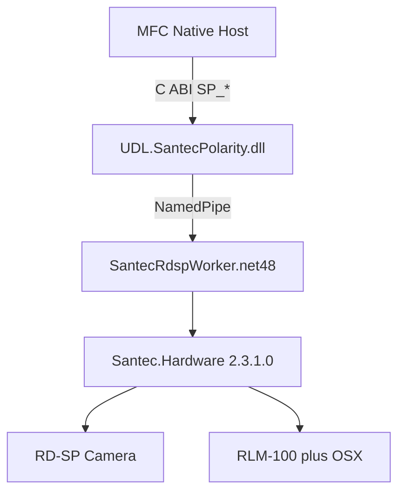

# Gate B 准入再评估（Hardware + RD-P + RLM Samples）

## 结论

**可以达到「启动实现」的基础要求（Gate B 最低门槛：YES）。**  
路径已锁定为：**Native `UDL.SantecPolarity` + 隔离 .NET Worker 调用 `Santec.Hardware` 2.3.1.0**（Host 不注入 CLR）。

**尚不能宣布 Gate B 完全关闭 / 量产冻结依赖。** 真机 PoC 与若干缺口仍在。

| 门禁 | 结果 |
|---|---|
| Gate A（Native OPL-SDK） | **否** — 三包内无 OPL header/lib/STDCALL |
| Gate B 最低（可开 Worker 开发） | **是** — Mapping API + RD-SP 类型面 + 样例流程齐 |
| Gate B 完整（依赖冻结） | **否** — 缺文档包、缺 SM/序列号样例证明、DLL 版本需钉死 2.3.1.0 |
| 仅靠 XNS Sample | 仍不够（上次结论不变） |

## 三包各自贡献

| 包 | 内容 | 作用 |
|---|---|---|
| [`Santec.Hardware-2.3.1.0`](SantecPolarity/doc/Santec.Hardware-2.3.1.0) | 仅 `Santec.Core.dll` + x86/x64 `Santec.Hardware.dll` | 运行时核心；反射可见 `IRDSP`/`RDSP`/`SimulatedRDSP`、Mapping API |
| [`RD-P Samples`](SantecPolarity/doc/RD-P%20Samples) | 3 个 C# 样例（含旧版自带 DLL） | 证明 Detect → `CreateRDP(rlm)` → Init → Map / Segmented Collect |
| [`RLM Samples`](SantecPolarity/doc/RLM%20Samples) | RLM IL/RL + Trace | 证明 Hardware.dll 控 RLM/挂接 Switch；**不含**极性 Mapping |

关键证据（[`RDPSample/Program.cs`](SantecPolarity/doc/RD-P%20Samples/C#/RDPSample/RDPSample/Program.cs)）：

- `RDPFactory.CheckForCamera` → 检测 RLM → `CreateRDP(rlm)` → `InitializeAsync`
- 一键：`MapPolarityAsync(12, expectedMapping)`
- 分段：`StartMappingPolarityAsync` → RLM 开激光/切通道 → `CollectOutputMappingDataAsync` → `ProcessMappingData` → `EndMappingPolarityAsync`
- `if (detector.IsRDSP)` 分支读 IL —— 样例承认 RD-SP 与 RD-P 同工厂路径

## 对照准入清单细项

| 项 | 判定 | 说明 |
|---|---|---|
| Detect/绑定 RD-SP 序列号 | **部分** | DLL 有 CameraSerial；样例只用 `CheckForCamera()`，未演示工位串号过滤 |
| 创建/初始化 composite | **部分→API 有** | `CreateRDP(rlm)`；需真机断言 `IsRDSP` / `IRDSP`；DLL 要求 RLM 已挂 OSX |
| Mode / Expected / Start-Collect-Process-End | **满足** | 样例完整覆盖 |
| Observed map / Dark / 诊断图 | **基本满足** | `int?` map + Collect bool + `GetOutputMappingImages`；Dark 语义需 PoC 对齐 Profile |
| Managed → Worker | **满足且必须** | 纯 CLR，无 native export |
| 证明 RD-SP-100-SM | **部分** | 有 `ERDSPModel.RDSP100` / `IsRDSP`；**无** `RD-SP-100-SM` 字面；SM 靠 `EFiberType.SingleMode` |
| Programming Guide / XML 文档 | **缺失** | `Santec.Hardware-2.3.1.0` 目录仅 3 个 DLL |
| 样例自带 DLL 版本 | **勿用** | 样例混用 1.4 / 1.19 / 1.12；Worker **必须钉 2.3.1.0 x64** |

## 仍建议向厂商补要

1. Hardware Library **Programming Guide**（官网有，本地未下）
2. 书面确认：`CreateRDP` + 我方 BOM（RLM-100-01-3500-S-09-FA-R / OSX 1x24 / RD-SP-100-SM）为支持组合
3. 多相机时按 Camera/Detector Serial 绑定的推荐写法
4. （可选）OPL-SDK —— 仅当仍想试 Gate A；当前三包已可走 Gate B，不必阻塞开发

## 对工程的直接含义

- [`UDL.SantecPolarity`](TestEquipmentDrivers/UDL.SantecPolarity) 可从「只返回 `SP_E_BACKEND_NOT_SUPPORTED`」进入 **Gate B Worker 实现阶段**（仍禁止虚构 `POLARITY:`*）。  
- 第一里程碑：Worker PoC 复刻 `RDPSample` 分段 Mapping，日志打印 `IsRDSP`、串号、Observed map。  
- 真机未过 PoC 前，不宣称产线可用。

## 默认技术决策（本评估锁定）

采用 **Gate B Worker**（.NET Framework 4.8 x64 + Hardware 2.3.1.0），不在本轮等待 OPL-SDK。Native UDL 继续 C ABI；RLM 激光/切通道在分段 Mapping 中按样例由 Hardware/`IRLM` 主控，并与现有 `UDL.SantecRLM` 做全局设备锁，避免双主控。