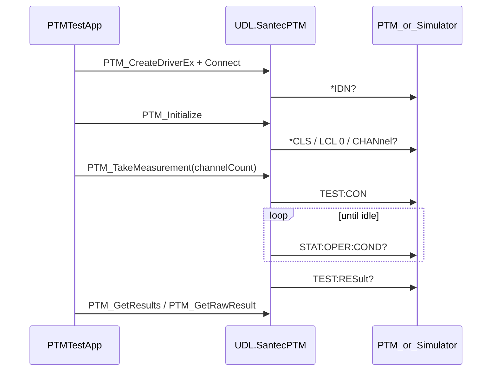

# Santec PTM 极性测试仪驱动实现计划

**Goal:** 新增 `UDL.SantecPTM`（TCP/VISA SCPI 驱动）+ `PTMSimulator` + `PTMTestApp`（仿 DriverTestApp3），并接入现有 [TestEquipmentDrivers.sln](TestEquipmentDrivers/TestEquipmentDrivers.sln)。

**Architecture:** 工程骨架与通信层直接克隆 [UDL.SantecRLM](TestEquipmentDrivers/UDL.SantecRLM)（同厂、同端口 5025、`\n` 结尾、VISA 动态加载）。测量语义按手册 Table 8：`TEST:CON#` → 轮询 `STAT:OPER:COND?` → `TEST:RESult?`。结果结构以 RLM 式 CSV 列表为默认假设，同时始终保存 raw 字符串，便于真机联调后只改解析器。

**Tech Stack:** C++/Win32 DLL（vcxproj）、MFC Dialog、console TCP simulator、`ws2_32` + 动态 VISA（[Common/VisaHelper.h](TestEquipmentDrivers/Common/VisaHelper.h)）。

## Global Constraints

- 协议来源：`PTM-User-Manual.pdf` 第 8 章（M-PTM_PT1-001.04）
- 默认 TCP 端口：**5025**；USB 走 VISA `USB?*INSTR`
- 命令终止符：`\n`；异步完成条件：`STAT:OPER:COND? == 0`（手册示例约 3s，驱动超时放宽到 30s）
- C ABI 前缀：**`PTM_`**（避免与 RLM 无前缀 `CreateDriver` 同进程冲突；加载方式仍为 `LoadLibrary`/`GetProcAddress`）
- Factory type 字符串：`"ptm"` / `"santecptm"`
- 本轮不做：操作台 App（SantecApp 级）、XN1 生产流水线 UI、网页/HID 集成

## Protocol Mapping

| 驱动能力 | SCPI |
|---|---|
| 连接校验 | `*IDN?` |
| 初始化 | `*CLS`, `LCL 0`, `CHANnel?` |
| 极性测试 | `TEST:CON#` |
| 等待完成 | `STAT:OPER:COND?` |
| 取结果 | `TEST:RESult?` |
| 单纤探测 | `DETECT#?` |
| VFL | `VFL#` / `FVFL#` / `LAS:OFF` |
| 本地面板 | `LCL #` / `LCL?` |
| 条码 | `READ:BARCode?` |
| 通知 | `TEST:NOTIFY# "string"` |
| XN1（导出可选） | `TEST:START` / `TEST:STAtus?` / `TEST:NEXT` / `TEST:RETRY` |
| 错误 | `SYST:ERR?` |
| 透传 | 任意 SCPI |

**结果解析约定（暂无，可调）：**
- Simulator / 默认解析器按 RLM 习惯输出逗号分隔数值：`out1,in1,out2,in2,...`（例如 Type-A 12 芯：`1,1,2,2,...,12,12`）
- 同时支持 `out:in` 对（`1:1,2:2,...`）与分号分组；解析失败时仍返回 raw，不判驱动失败
- `CPolarityChannelResult`：`outputChannel`, `inputChannel`, `rawData[4]`；另提供 `PTM_GetRawResult` 取完整字符串

## File Layout

### 1. Driver — `TestEquipmentDrivers/UDL.SantecPTM/`（克隆 RLM 并改名）

| 来源 RLM | 新文件 |
|---|---|
| `IEquipmentDriver.h` / `BaseEquipmentDriver.*` | 精简为 `ISantecPTMDriver.h`（去掉波长/参考/IL-RL；保留 Connect/Init/Measure/Results/Raw） |
| `SantecDriver.*` | `SantecPTMDriver.*` |
| TCP 内嵌于 Driver | 拆出或保留：`SantecPTMTcpAdapter`（同 RLM 行为） |
| `SantecVisaAdapter.*` | `SantecPTMVisaAdapter.*` |
| `DriverFactory.*` / `DriverExports.*` / `.def` | `PTMDriverFactory.*` / `PTMExports.*` / `UDL.SantecPTM.def` |
| `DriverTypes.h` / `Logger.*` / `dllmain.cpp` / `stdafx.*` | `PTMTypes.h` + 同名支持文件 |
| — | `PTMScpiCommands.h`（集中 Table 7/8 常量） |
| — | `docs/UDL.SantecPTM-API.md` |

**C ABI（核心）：** `PTM_CreateDriver` / `PTM_CreateDriverEx` / `PTM_DestroyDriver` / `PTM_Connect` / `PTM_Disconnect` / `PTM_Initialize` / `PTM_IsConnected` / `PTM_GetChannelCount` / `PTM_TakeMeasurement` / `PTM_GetResults` / `PTM_GetRawResult` / `PTM_Detect` / `PTM_SetLocalMode` / `PTM_LaserOff` / `PTM_SetVfl` / `PTM_GetBarcode` / `PTM_Notify` / `PTM_GetDeviceInfo` / `PTM_CheckError` / `PTM_SendCommand` / `PTM_SetLogCallback` / `PTM_EnumerateVisaResources`；XN1 四个命令一并导出供后续产线使用。

**关键实现细节：**
- `WaitUntilIdle`：循环 `STAT:OPER:COND?`，间隔 10–50ms，超时 30s
- `TakeMeasurement(n)`：`n<=0` 时用 `CHANnel?` 全通道；写 `TEST:CON{n}` → WaitIdle → `TEST:RESult?` → 存 raw + Parse
- 复用 RLM 的 `ParseDoubleList` 思路做成 `ParsePolarityMap`
- CommType：0=TCP，2=VISA；GPIB/DLL stub 打日志返回 false（与 RLM 一致）

### 2. Simulator — `TestEquipmentDrivers/PTMSimulator/`

仿 [SantecSimulator](TestEquipmentDrivers/SantecSimulator)：console TCP SCPI server，默认 `--port 5025`。

实现 Table 8 + 必要 Table 7（`*IDN?` 返回 `SANTEC,PTM,...`，`*CLS`，`SYST:ERR?`，`STAT:OPER:COND?`）。
- `TEST:CON#`：置 busy → 短延时 → idle，生成 Type-A 直通映射 CSV
- `TEST:RESult?`：返回该 CSV（与驱动默认解析器一致）
- `DETECT#?`：回 `#`（最亮探测器=自身）
- `CHANnel?`：可配置 12/24（`--channels`）
- VFL / LCL / BARCode / NOTIFY / XN1 `STAtus?` 返回 `PASS` 的最小桩

### 3. MFC 调试工具 — `TestEquipmentDrivers/PTMTestApp/`

克隆 [DriverTestApp3](TestEquipmentDrivers/DriverTestApp3)：
- `SantecPTMDllLoader.h`（映射全部 `PTM_*`）
- 对话框：Load/Unload、TCP/VISA、Connect、Initialize、通道数、Take Measurement、Get Results（表格：Out→In）、Show Raw、Detect、VFL/Laser Off、Local Mode、Send Raw SCPI、日志窗口
- 默认连 `127.0.0.1:5025`（Simulator）

### 4. Solution / 文档

- 更新 [TestEquipmentDrivers.sln](TestEquipmentDrivers/TestEquipmentDrivers.sln)：Drivers / SImulators / UITestApps 各加一项
- 新增 `docs/UDL.SantecPTM-API.md`（对照现有 [docs/UDL.SantecRLM-API.md](docs/UDL.SantecRLM-API.md)）
- 在 API 文档中明确标注：**TEST:RESult? 格式为暂定 CSV，真机确认后只改 `ParsePolarityMap` + Simulator 输出**

## Verification

1. 编译 `UDL.SantecPTM` / `PTMSimulator` / `PTMTestApp`（Debug|x64）
2. 启动 Simulator → PTMTestApp Connect → Initialize → Measure → 表格显示 1→1…N→N，Raw 区有完整字符串
3. VFL / Detect / Laser Off / raw `*IDN?` 通路可用
4. 断开/重连与错误日志无崩溃

## Out of Scope（明确不做）

- 自定义极性 profile 下发（手册网页侧功能，SCPI Table 8 无对应命令）
- Excel 导出 / 产线 XN1 服务器流程 UI
- 与 OSX/RLM 联机的综合 App