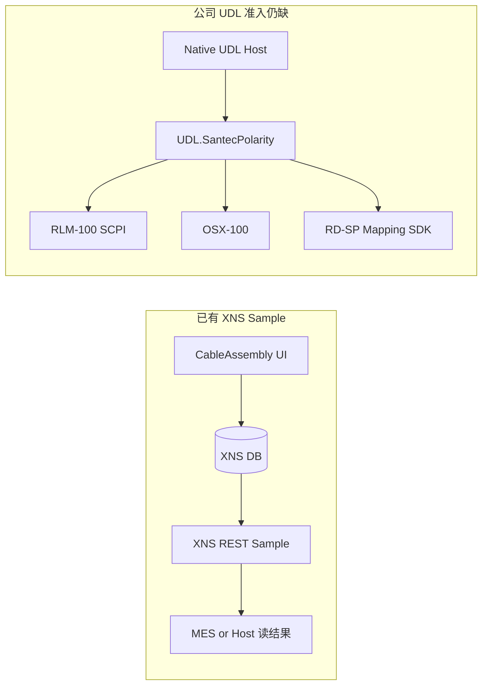

# XNS-API-Samples 准入评估结论

## 一句话结论

**不满足**公司 `UDL.SantecPolarity`（RLM-100 + OSX-100 + RD-SP-100-SM）Mapping 驱动的 Gate A / Gate B 准入。  
当前包只证明：**测完之后**可以用 REST 从 XNS 拉/订阅结果（含 polarity map 字段）；**不能**开激光、切 OSX、驱动 RD-SP 或执行 Mapping。

## 官网 Programming 页 vs 你已下载内容

[Programming and Drivers](https://inst.santec.com/resources/programming) 上与极性相关的资源是多包并列的；你本地 [`SantecPolarity/doc/XNS-API-Samples`](SantecPolarity/doc/XNS-API-Samples) 只对应其中 **「XNS API Sample Code」** 这一项。

| 官网资源 | 本地是否有 | 与准入关系 |
|---|---|---|
| XNS API Documentation / Sample | 有 Sample（本包） | 仅 MES/结果集成，非 Mapping 驱动 |
| Cable Assembly API Documentation | **无** | 可能支持推 Test Plan 进 Cable Assembly UI，仍非自研 UDL Mapping |
| Santec Hardware Library Programming Guide + `.dll` 2.3.1.0 | **无** | **Gate B 必需** |
| RD-P-100/RD-SP-100 Sample Code | **无** | **Gate B 必需** |
| Santec OPL-SDK | **无** | **Gate A 必需** |
| RLM-100 Sample Code | **无** | 对复用 SCPI/库有帮助，但不是极性 Mapping 核心 |

厂商说「资料都在这个页面」= 资料入口在这里；**不等于**只下 XNS Sample 就够用。

## 本包实际能力（已核对源码）

基址：`http://{xns}:8083`

- `GET /integration/results/combined-measurements?dutSn=`
- `GET /integration/results?dutSn=`
- `GET /integration/results/filter-results?...`
- `POST /api/subscribers/create-subscriber` + 本机监听 8555/8556 收推送

C# 反序列化里有 `expectedMap` / `detectedMap` / `polarityFibers`（结果形态），但 Python 注释写明要先在 **Cable Assembly Application** 里跑测试。无 `Santec.Hardware` 引用、无 VISA/OPL、无 RD-SP/RLM/OSX 控制。

## 对照 [`docs/RD-SP-SDK-供应商索取清单.md`](docs/RD-SP-SDK-供应商索取清单.md)

| 门禁项 | 结果 |
|---|---|
| Gate A Native OPL-SDK RD-SP Mapping | **未满足**（包未下载） |
| Gate B `Santec.Hardware.dll` + RD-SP Sample | **未满足**（包未下载） |
| XNS：无 UI 推计划并开测 | **未满足**（本 Sample 无 push/start；Cable Assembly API 文档未下） |
| XNS：测后取极性结果 | **满足（读侧）** — 可作 MES 对接参考 |
| 极性是否有 SCPI | 本包**无法否定也无法确认**；仍无 Mapping SCPI 证据 |

## 推荐下一步（确认本结论后执行）

从同一 Programming 页**按优先级补下**并放进 `SantecPolarity/doc/`（勿装到产线机乱改环境前先只做离线审阅）：

1. **Santec Hardware Library (.dll) 2.3.1.0** + Programming Guide
2. **RD-P-100/RD-SP-100 Sample Code**（必须能证明是 RD-SP 路径，不是仅 RD-P）
3. **Santec OPL-SDK**（用于 Gate A 对照；若无 RD-SP Mapping 则书面记 Fail → 走 Gate B Worker）
4. **Cable Assembly API Documentation**（评估「推计划进厂商软件」备选，与自研 UDL 并行存档）
5. （建议）**RLM-100 Sample Code** 作 SCPI/库交叉参考

审阅通过后再改 `UDL.SantecPolarity`：选 Gate B Worker 或 Gate A Native，解除 `SP_E_BACKEND_NOT_SUPPORTED`。

## 对现有工程的含义（不变）

- 冻结的虚构 `POLARITY:*` stub：**仍不可用**  
- `UDL.SantecPolarity` 骨架：**继续保持** `SP_E_BACKEND_NOT_SUPPORTED`  
- XNS Sample：**可保留**作结果 JSON schema / MES 订阅参考，**不得**当作 Mapping 后端